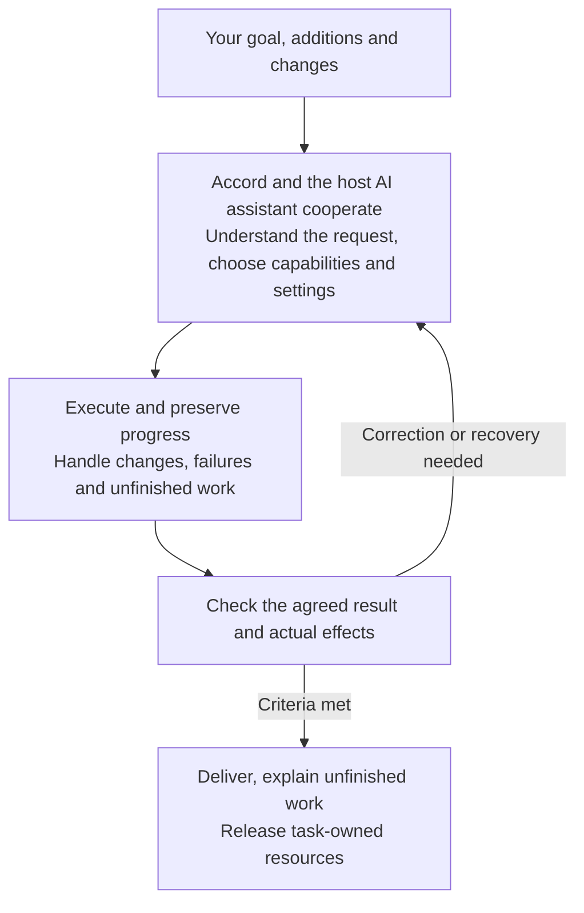

# YIYUAN Accord

<p align="center">
  <a href="https://github.com/yiheng8023/YIYUAN-Accord/actions/workflows/validate.yml"></a>
  <a href="https://github.com/yiheng8023/YIYUAN-Accord/releases/latest"></a>
  <a href="https://github.com/yiheng8023/YIYUAN-Accord/stargazers"></a>
  <a href="LICENSE"></a>
</p>

<p align="center">
  <a href="README.md">English</a> | <a href="README.zh-CN.md">简体中文</a>
</p>

**Make tools adapt to people, rather than making people adapt to tools.**

YIYUAN Accord is an open-source human–AI collaboration system. Its goal is to let you describe what you want to achieve while the AI assistant and its host work together to understand the request, choose capabilities, carry out the task and check the result. You should not have to study the host's settings, options, models, tools and workflows before coordinating them yourself.

Accord's general design is independent of any model vendor or host. **The current release provides a Codex adaptation for OpenAI environments.** Other host integrations remain future work; this does not imply support for every host or every OpenAI entry.

## What problem it addresses

- **Many tools, but you have to coordinate them.** Let the assistant discover and coordinate host, Accord and third-party capabilities, including necessary settings and dependencies. Ask you only for a decision, authorization or action that actually needs you.
- **Requirements change, but earlier work does not follow.** Incorporate additions and changes, correct affected work, and preserve requirements and results that remain valid.
- **An interruption means explaining everything again.** Preserve goals, progress and unfinished work for recovery through supported host workflows.
- **Much activity, but no clear completion.** Check the agreed result, actual effects and cleanup, and explain what remains.

These goals need continuing validation on real tasks. A fair enabled/disabled comparison is being prepared, covering result quality, human intervention, time and usage; **no measured benefit figures are offered yet**. See the [comparison protocol](docs/operations/LAUNCH-v3.3.md#启用与未启用对照准备).

## Get started

The current release is [3.3.4](https://github.com/yiheng8023/YIYUAN-Accord/releases/tag/v3.3.4). Use a Codex CLI or desktop entry that supports plugins, with a compatible Node executable available to that host; Node 24 is the current tested recommendation. Ordinary use does not require Python.

1. **Install.** Install YIYUAN Accord from this repository's marketplace source. To register that source from the CLI:

   ```sh
   codex plugin marketplace add yiheng8023/YIYUAN-Accord --ref v3.3.4
   ```

2. **Enable plugins and Accord.** Allow plugin use in the host and enable Accord in the scope you actually use. In CLI `/plugins`, select the marketplace, install, and press `Space` on the installed plugin to turn it on or off.
3. **Review and trust the Hooks on first use.** Hooks are plugin scripts run at task events. Installation or enablement does not trust them automatically. In CLI `/hooks`, review and trust Accord's current definitions. The installation executor must verify the supported desktop method for your version; see the user guide.
4. **Start a new task and describe the goal.** For example: “Help me complete this task. If conditions change, correct the affected work and check the result before delivery.”

**Installation, enablement, Hook trust and actual loading are all necessary.** See the [user guide](docs/user-guide.md#english-user-guide) for complete steps, an installation request template and troubleshooting. Current official documentation does not support native plugins in the Codex IDE extension; running CLI in an editor terminal is a different route. See [entry limitations](docs/user-guide.md#current-entries-and-runtime).

## How it works



The host supplies models, tools and execution; Accord adds coordination, continuity and verification mechanisms. Real work can run in parallel, nest or return to an earlier step. This is a responsibility overview; see the [user guide](docs/user-guide.md#principles-and-further-reading), [architecture](docs/architecture.md) and [detailed system diagram](docs/operations/PLAN-v3.3.md#稳定关系与动态方法) for the full relationships.

## Before you use it

- Your chosen models, reasoning effort and usage limits remain in force. Accord cannot bypass host permissions or enable features you have disabled, and does not require resetting your environment. Subagents are optional.
- Accord does not train models, enlarge context windows or add conversation turns automatically. Long-running work still uses host capabilities under your choices.
- With the input Hook enabled, root-task input is retained locally for recovery and may contain sensitive text; ending a session does not necessarily delete it immediately. See [input retention and privacy](docs/user-guide.md#input-retention-and-privacy).
- Coordination may add context, latency and compute overhead. Existing qualification and CI have bounded scopes and do not replace a comparison of ordinary-use benefits. See [versions and evidence](docs/user-guide.md#versions-and-evidence).

## Learn more and participate

[User guide](docs/user-guide.md#english-user-guide) · [Design and current plan](docs/operations/PLAN-v3.3.md) · [Acceptance criteria](docs/operations/ACCEPTANCE-v3.3.md) · [Current continuation](docs/operations/CONTINUATION.md) · [Changelog](CHANGELOG.md)

See [Contributing](CONTRIBUTING.md) for development, evaluation and maintainer checks. For help, start with what you expected and what happened in your own words; see [Support](SUPPORT.md). Do not publish credentials or private raw transcripts. Report security issues under the [security policy](SECURITY.md).

## Vision and collaboration

**Our declaration: Empower every dream.**

The project is open source and not driven by profit. It aims for industrial and commercial production quality, equitable access and user autonomy. Decisions follow user interests, verifiable value and sustainable maintenance; funding and platform relationships do not change vendor independence.

YIYUAN NEXUS will continue exploring human–machine collaboration and related fields. Accord evolves with frontier intelligence, human and machine capabilities, and ways of working together. When its mission is fulfilled, carried forward by better mechanisms or no longer needed, it should be able to conclude responsibly and in an orderly way.

There is currently one author-maintainer, with limited capacity, time and resources. Community collaboration is welcome. More host integrations and other directions will be evaluated without promising future version numbers, dates or compatibility outcomes.

Thank you to all [contributors](https://github.com/yiheng8023/YIYUAN-Accord/graphs/contributors). [Issues and suggestions](https://github.com/yiheng8023/YIYUAN-Accord/issues) · [Star history](https://www.star-history.com/#yiheng8023/YIYUAN-Accord&Date)

## License and support

An independent community project maintained by [yiheng8023](https://github.com/yiheng8023), licensed under [Apache-2.0](LICENSE) and provided “AS IS”; it is not a host vendor's product or endorsement. See [NOTICE](NOTICE), the [license policy](docs/license-policy.md) and [third-party notices](THIRD_PARTY_NOTICES.md) for names, marks and attribution. Users remain responsible for reviewing outputs and following applicable rules. A release does not establish production safety or fitness for a particular purpose.

[Voluntary sponsorship](SPONSORING.md) lists the published payment channels and QR codes. Sponsorship does not purchase a service level, priority, feature commitment or influence over technical decisions. Community support is best-effort under [SUPPORT.md](SUPPORT.md).
