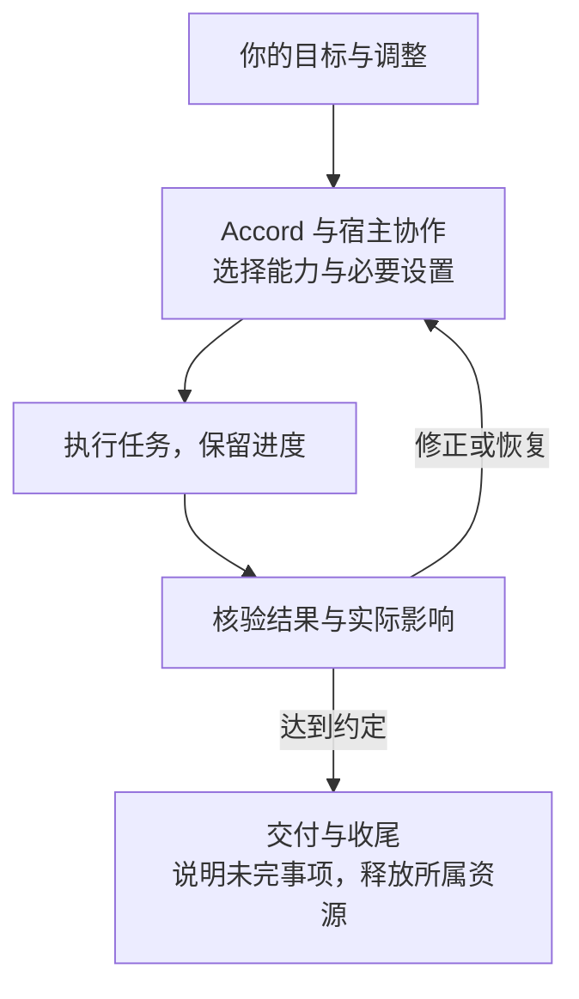

# YIYUAN Accord

<p align="center">
  <a href="https://github.com/yiheng8023/YIYUAN-Accord/actions/workflows/validate.yml"></a>
  <a href="https://github.com/yiheng8023/YIYUAN-Accord/releases/latest"></a>
  <a href="https://github.com/yiheng8023/YIYUAN-Accord/stargazers"></a>
  <a href="LICENSE"></a>
</p>

<p align="center">
  <a href="README.zh-CN.md">简体中文</a> | <a href="README.md">English</a>
</p>

**让工具适应人，而非人适应工具。**

YIYUAN Accord 是开源的人与 AI 协作系统。它的目标是让你直接说想完成什么，由 AI 助手与宿主共同理解需求、选择能力、推进任务并核对结果。你不必先研究宿主的设置、选项、模型、工具和工作流程，再亲自把它们组织起来。

Accord 的通用设计不绑定某一家模型厂商或宿主。**当前发行提供 OpenAI 环境下的 Codex 适配**，其它宿主适配属于后续方向；这不代表当前已经支持所有宿主或所有 OpenAI 入口。

## 它要解决什么问题

- **工具很多，却需要你自己调度。** 让助手按任务发现和协调宿主、Accord 及第三方能力，处理必要设置与依赖；只有确需你决定、授权或本人操作时才打扰你。
- **需求改了，旧成果没有跟上。** 跟进补充和调整，修正受影响的工作，保留仍然有效的要求与成果。
- **中断后，要重新交代一遍。** 在宿主支持的流程中保留目标、进度和未完事项，为继续工作提供恢复依据。
- **做了很多，却难以判断是否完成。** 按约定核对成果、实际影响和收尾情况，说明剩余问题。

这些目标需要持续检验。首轮两对小型任务试行中，两组交付均正确，启用组用量和耗时更高。**样本很小，不能据此推断普遍收益或性能差异。** 见[试行结果与条件](research/evaluations/accord-toggle-v1.md#2026-10-30-首轮有限试行)。

## 开始使用

当前正式版为 [3.3.8](https://github.com/yiheng8023/YIYUAN-Accord/releases/tag/v3.3.8)。请选择支持插件的 Codex CLI 或桌面入口，并确保该宿主能运行兼容 Node（当前受测推荐为 Node 24）。普通使用不需要 Python。

1. **安装。** 从本项目来源安装 YIYUAN Accord；CLI 登记来源可使用：

   ```sh
   codex plugin marketplace add yiheng8023/YIYUAN-Accord --ref v3.3.8
   ```

2. **启用插件。** 确认宿主允许使用插件，并在实际使用范围内启用 Accord。CLI 在 `/plugins` 中选择来源、安装，并对已安装项按 `Space` 启停。
3. **首次审阅并信任 Hook。** Hook 是在任务事件发生时运行的插件脚本。安装或启用插件不会自动信任它们；CLI 可在 `/hooks` 中审阅并信任 Accord 的当前定义。桌面的具体方式由安装执行者按所用版本核实，见用户指南。
4. **新建任务，直接描述目标。** 例如：“帮我完成这件事；中途有变化时，继续修正受影响的工作，并在交付前检查结果。”

**安装、启用、Hook 信任和实际加载缺一不可。** 完整步骤、安装请求模板及未生效排查见[用户指南](docs/user-guide.md#中文使用指南)。当前官方文档不支持 Codex IDE 扩展原生插件入口；在编辑器终端运行 CLI 是另一条路线，见[具体入口限制](docs/user-guide.md#当前入口与运行条件)。

## 如何工作



宿主提供模型、工具和执行能力；Accord 补充任务协调、连续性和核验机制。实际工作可以并行、嵌套或返回前一步，这张图是职责总览。原理及完整关系见[用户指南](docs/user-guide.md#原理与进阶阅读)、[架构](docs/architecture.md)和[详细系统图](docs/operations/PLAN-v3.3.md#稳定关系与动态方法)。

## 使用前需要知道

- 你的模型、推理强度和使用限制继续有效；Accord 不能越过宿主权限、替你启用已关闭的功能，也不要求先重置现有环境。子代理是可选能力。
- Accord 不训练模型、不扩大上下文，也不自动增加对话回合。长程运行仍使用宿主能力并遵循你的选择。
- 启用输入 Hook 后，根任务输入会保留在本机用于恢复，可能包含敏感文字；退出会话不一定立即删除。见[隐私与保存](docs/user-guide.md#输入保存与隐私)。
- 额外协调可能增加上下文、耗时和计算开销。已有验收和 CI 各有适用范围，不能替代普通使用中的收益对照。见[版本与证据](docs/user-guide.md#版本与证据)。

## 进一步了解与参与

[用户指南](docs/user-guide.md#中文使用指南) · [设计与当前计划](docs/operations/PLAN-v3.3.md) · [验收依据](docs/operations/ACCEPTANCE-v3.3.md) · [当前接续](docs/operations/CONTINUATION.md) · [更新日志](CHANGELOG.md)

开发、评估和维护检查见[贡献指南](CONTRIBUTING.md)；遇到问题可以先用自己的话说明期望和实际结果，见[支持说明](SUPPORT.md#支持说明)。请勿公开凭据或私密会话原文，安全问题按[安全政策](SECURITY.md)报告。

## 愿景与共创

**宣言：助力每一个梦想。**

项目开源，不以盈利为目标，以工业/商业生产级质量为建设方向，追求平权、普惠和用户自主。项目决策以用户权益、可验证价值和可持续维护为依据；商业资助和平台关系不改变供应商中立原则。

易元联创（YIYUAN NEXUS）将持续探索人机协作及相关领域。Accord 会随前沿智能、人与机器能力及协作方式演进；当使命完成、被更好的机制承接或不再需要时，也应能负责任地有序谢幕。

目前仅有一名作者兼维护者，能力、精力和资源有限。欢迎社区联合创作、协同前行；更多宿主适配等方向会持续评估，不预设未来版本号、日期或兼容性承诺。

感谢所有[贡献者](https://github.com/yiheng8023/YIYUAN-Accord/graphs/contributors)。[问题与建议](https://github.com/yiheng8023/YIYUAN-Accord/issues) · [Star 增长趋势](https://www.star-history.com/#yiheng8023/YIYUAN-Accord&Date)

## 许可与支持

由 [yiheng8023](https://github.com/yiheng8023) 维护的独立社区项目，采用 [Apache-2.0](LICENSE)，按“原样”提供；不是宿主厂商的产品或官方背书。名称、商标及第三方声明见 [NOTICE](NOTICE)、[许可政策](docs/license-policy.md)与[第三方声明](THIRD_PARTY_NOTICES.md)。用户仍需审查输出并遵守适用规则，正式发布不保证特定用途的适用性或生产安全。

[自愿赞助与支持](SPONSORING.zh-CN.md)包含公开渠道及收款码。赞助不购买服务等级、优先级、功能承诺或技术决策影响力；社区支持按 [SUPPORT.md](SUPPORT.md) 尽力提供。
