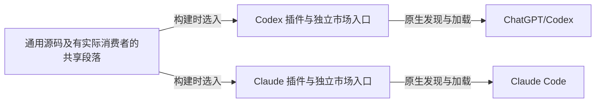

# 多宿主适配的共享范围、发现入口与用量

2026-11-19。以 ChatGPT/Codex 3.3.18 和独立的 Claude Code 本地候选为实例，核对共享维护、独立分发和普通会话负担。本文记录研究、方案与本轮的生命周期构建复验。交付状态见[当前计划](../../docs/operations/PLAN-v3.3.md#current-work)。

**适配层可以局部共享。** 宿主把原生输入各自转换为语义相同的数据后，共用处理逻辑需要满足相同的权限边界、结果和失败语义。建议从同一来源维护共同部分，在构建时按宿主生成独立插件及安装入口。每个宿主使用自己的包、配置和生命周期，因此可以独立升级与回滚。

## Accord 已经共享了什么

在 r120 用当时的构建器在临时目录重建 Claude dev.2，与 Codex 3.3.18 按相对路径逐文件比较。包内分别有 14 和 30 个成员。许可与声明文件、协调入口、能力协调、结果核验三项 Skill，以及中英文元指导共七个成员在这次比对中字节相同。两端分别使用自己的 manifest、Hook 声明、入口脚本及原生能力参考。连续性和插件生命周期的 Skill 共享一部分正文，后续接各自实现。Codex 的状态 MCP 和原生会话代码留在 Codex 包内。统计限于包内成员，外部市场清单与构建记录单列。[Claude 构建器](../../scripts/build_claude_plugin.py) · [Codex 插件清单](../../plugins/yiyuan-accord-codex/.codex-plugin/plugin.json) · [Codex Hook 声明](../../plugins/yiyuan-accord-codex/hooks/hooks.json)

r121 拆分前，构建器从 Codex 插件目录取得多项源码，以 `In Codex` 开头的行标记 `manage-plugin-lifecycle` 的宿主专属内容，连续性指导则按标题切分。把当时构建记录列出的源码复制到临时目录，原样构建成功。只把该句开头改成 `For Codex`，Claude 构建退出 1 且未生成输出。这次观察确认 Codex 的文档措辞当时是 Claude 构建依赖。[拆分后的复验](#lifecycle-source-result)

两端交互的时序和语义仍各自取证。Claude 独立 CLI 的受控写入案例中，宿主报告终态时写入器还活着，随后才退出并由磁盘读回确认副作用。可以共享“核实际停止与效果”的义务和判据，具体中断请求、终态、进程及目标状态仍从对应宿主核对。[Claude 写入实证](2026-09-28-plugin-eval-and-accord-comparison.md#claude-code-cli-interrupted-write)

## 两家宿主实际从哪里取内容

### 入口发现与安装

ChatGPT 桌面的本地市场支持 `.agents/plugins/marketplace.json`，也兼容仓库根的 `.claude-plugin/marketplace.json`。本机 Codex CLI 0.170.0 的固定版本源码对单一根目录采用按顺序查找首个清单的行为。目录名和当前优先级都不是跨版本隔离契约。另有配置为禁用但仍刷新文件的分支。因此，隔离应体现在 Accord 向该宿主登记的市场根及其中列出的包。当前仓库的 Codex 市场只列 Codex 插件，Claude 市场随单独的构建输出生成。[OpenAI 本地市场](https://developers.openai.com/plugins/build/plugins#how-local-marketplaces-work) · [启用及刷新](https://developers.openai.com/plugins/build/plugins#enable-or-disable-a-plugin-for-a-repo) · [Codex 0.170.0 查找顺序](https://github.com/openai/codex/blob/rust-v0.170.0/codex-rs/core-plugins/src/marketplace.rs#L19-L24) · [首个匹配的实现](https://github.com/openai/codex/blob/rust-v0.170.0/codex-rs/core-plugins/src/marketplace.rs#L304-L313) · [当前 Codex 市场](../../.agents/plugins/marketplace.json)

Codex 的直接 Skill 扫描和插件安装缓存有不同的文件处理。0.170.0 的缓存复制只处理普通目录与文件。Claude 的同市场构建复制能在特定条件下把链接实体化，其他来源又有不同规则。`--plugin-dir` 传集合目录还可能选择多个子包。独立分发宜把运行所需文件作为真实成员生成到包里，使用包内相对链接。验收时把产物移出源码树并用精确包根测试。[Codex 缓存复制](https://github.com/openai/codex/blob/rust-v0.170.0/codex-rs/core-plugins/src/store.rs#L688-L706) · [Claude 市场链接规则](https://code.claude.com/docs/en/plugins/host-marketplace#share-files-within-a-marketplace-with-symlinks) · [Claude 本地测试](https://code.claude.com/docs/en/plugin-dependencies#test-a-plugin-and-its-dependency-locally)

### 进入模型上下文的内容

两端通常先发现 Skill 的名称和描述，选中后才加载正文。参考资料按任务读取。Claude 的子代理可以显式预加载 Skill。受信 Hook 另有入口，它可调用文件并把输出送进上下文。缩小市场清单控制可见范围，裁剪 Hook 和 Skill 则控制普通任务的输入负担。两者可以分别验证。[OpenAI Skills](https://learn.chatgpt.com/docs/build-skills) · [Codex Hook 信任](https://learn.chatgpt.com/docs/hooks#review-and-trust-hooks) · [Claude Skills](https://code.claude.com/docs/en/skills#control-who-invokes-a-skill) · [Claude 子代理预加载](https://code.claude.com/docs/en/sub-agents#preload-skills-into-subagents)

Accord 的现行 Codex 入口 Hook 从包内读取协调 Skill 正文与英文元指导。Claude 候选的早期 Hook 返回 11,213 字符，受测桌面首请求里连续匹配到开头 1,961 字符。改用短入口后，实际首请求收到了全部 1,580 字节，完整指导随包可查。Anthropic 现行文档说明长输出可被替换为会话文件路径与预览，这与早期形态吻合。该次截短的具体成因仍待原件确认。这两次观察记录的是实际传递内容。各自单位是字符和字节，token 与端到端开销需要另测。[Codex 入口实现](../../plugins/yiyuan-accord-codex/runtime/task-checkpoint.cjs) · [Claude Hook 输出约束](https://code.claude.com/docs/en/hooks#add-context-for-claude) · [桌面首请求实证](2026-09-28-plugin-eval-and-accord-comparison.md#claude-code-desktop-guidance)

开发工作区可以按需查阅整个仓库。Claude 在特定版本和项目设置下也会读取普通 `AGENTS.md`，Accord 已在 Squirrel 的临时项目观察过。根级指导适合保留双方都需要遵守的开发约定。维护某个适配时按任务查它的实现和参考。这和日常使用插件时控制自动发现、注入和调用范围是两件事。[Claude 项目指令](https://code.claude.com/docs/en/memory#agentsmd) · [临时项目观察](2026-09-28-plugin-eval-and-accord-comparison.md#claude-code-desktop-guidance)

## 三个可核对的设计选择

### Agent Skills 如何分配上下文

格式规范建议启动时提供名称和描述，选用后加载正文，执行需要时再读参考资料、脚本或资产。正文宜以 Skill 根为基准使用相对路径。客户端指南把扫描目录和索引过滤交给宿主管理，`.agents/skills` 是可选的跨客户端目录约定。`compatibility` 描述使用条件，过滤是否生效仍取决于宿主。规范中的 token 数值是写作参考，实际输入量按各宿主观察。[分阶段加载与相对路径](https://agentskills.io/specification#progressive-disclosure) · [发现目录](https://agentskills.io/client-implementation/adding-skills-support#where-to-scan) · [索引过滤](https://agentskills.io/client-implementation/adding-skills-support#filtering) · [兼容性字段](https://agentskills.io/specification#compatibility-field)

这给 Accord 两个独立的控制点。构建清单先决定本宿主能发现哪些技能；正文只列当前任务可能需要、且当前包可兑现的参考。若 Hook 主动注入某段正文，该段就在 Hook 触发时产生输入，预算应记在该次注入。将其放在名为 `references` 的目录即使便于维护，也不会自动推迟 Hook 的读取。

### Vercel Skills 的安装目标怎样影响其他宿主

Vercel 安装器将 Claude Code 项目目录映射为 `.claude/skills`，Codex 的项目与用户级目录均使用相应作用域下的 `.agents/skills`。对普通本地或克隆来源，单一目标目录默认直接复制。涉及多个不同目录通常选符号链接。复制写到选定目录。符号链接模式先写入共用目录，再为需要的宿主建链接。建链接失败时可以回退为在该宿主目录复制并记录结果。[宿主目录映射](https://github.com/vercel-labs/skills/blob/57217cf86ba38148a57af9e90d14a4c049558330/src/agents.ts#L166-L175) · [Codex 映射](https://github.com/vercel-labs/skills/blob/57217cf86ba38148a57af9e90d14a4c049558330/src/agents.ts#L235-L242) · [CLI 的默认选择](https://github.com/vercel-labs/skills/blob/57217cf86ba38148a57af9e90d14a4c049558330/src/add.ts#L479-L490) · [复制与共用目录](https://github.com/vercel-labs/skills/blob/57217cf86ba38148a57af9e90d14a4c049558330/src/installer.ts#L374-L430) · [回退路径](https://github.com/vercel-labs/skills/blob/57217cf86ba38148a57af9e90d14a4c049558330/src/installer.ts#L458-L471)

对 Accord 的启示有明确条件。单选 Claude、按上述直接复制到它的专属目录，就不会由这条复制路径额外写入共用根。若选择共用目录作为目标或中转，其他扫描同一根的客户端也可能发现其中的技能，用户级安装还会跨项目可见。仅看安装命令勾选了哪些宿主容易漏判。构建期从一份源码分别拷入独立包能保留源码复用的收益，代价是两边要各自校验、发布和更新。以上是安装器源码能推出的磁盘路径及条件，本轮未运行该工具或观测某台机器的发现结果。[共用根与作用域](https://github.com/vercel-labs/skills/blob/57217cf86ba38148a57af9e90d14a4c049558330/src/installer.ts#L116-L146) · [作用域及模式选择](https://github.com/vercel-labs/skills/blob/57217cf86ba38148a57af9e90d14a4c049558330/src/add.ts#L3030-L3082)

### Superpowers 如何从一个仓库交付不同入口

Superpowers 7.0.2 的 Claude 开发市场指向仓库根。其 Hook 对启动、清空和压缩等匹配事件调用脚本，脚本读入整个 `using-superpowers/SKILL.md`，组装为 Claude 的 `additionalContext`。同一提交的 Codex manifest 指向 `./skills/` 并显式设置空 hooks 对象。面向 Codex 门户的打包脚本从选定 Git ref 取出指定的顶层文件和目录，排除根 hooks 和 Claude manifest，再从指定的既有官方包补齐每项技能的 OpenAI 专属元数据；缺少任一项就终止构建。可复用的做法是共用正文、按宿主拥有入口和元数据，并在打包时核对归属。这种写法也新增了一个可追溯的构建输入，即对应的元数据来源。[Claude 市场入口](https://github.com/obra/superpowers/blob/22f0b463e7a5e579904dd6211a520321035526f7/.claude-plugin/marketplace.json#L8-L15) · [Claude 事件](https://github.com/obra/superpowers/blob/22f0b463e7a5e579904dd6211a520321035526f7/hooks/hooks.json#L3-L13) · [正文读取与注入](https://github.com/obra/superpowers/blob/22f0b463e7a5e579904dd6211a520321035526f7/hooks/session-start#L24-L81) · [Codex 入口](https://github.com/obra/superpowers/blob/22f0b463e7a5e579904dd6211a520321035526f7/.codex-plugin/plugin.json#L23-L25) · [构建输入与校验](https://github.com/obra/superpowers/blob/22f0b463e7a5e579904dd6211a520321035526f7/scripts/package-codex-plugin.sh#L233-L282)

上述脚本把整个 `skills` 目录列入归档，共享入口仍列出 Claude Code、Codex 等多个宿主的资料路径，并要求选读自己的文件。参考正文按需读取，多宿主索引则留在入口。Accord 可以用构建清单选入本宿主的参考文件及对应索引行。多出来的构建维护集中在这份清单，两个索引可分别检查。实际用量仍需在各宿主记录。[打包路径](https://github.com/obra/superpowers/blob/22f0b463e7a5e579904dd6211a520321035526f7/scripts/package-codex-plugin.sh#L233-L242) · [正文中的各宿主资料索引](https://github.com/obra/superpowers/blob/22f0b463e7a5e579904dd6211a520321035526f7/skills/using-superpowers/SKILL.md#L45-L56)

OpenAI 自己的 Developers 插件提供另一个接近 Accord 的取舍。Claude Code 和 Cursor 获得可移植的 Skills 与 Docs MCP，ChatGPT/Codex 发行使用自身的专属连接能力。这说明共享便携内容和分别交付宿主能力可以同时存在。[OpenAI Developers 插件的分宿主说明](https://developers.openai.com/learn/developers-codex-plugin)

## 建议保留的共享范围

| 内容 | 建议归属 | 判断方式 |
| --- | --- | --- |
| 用户意图、授权、接续、核验和最小介入等规则 | 通用层，保留一份作者维护的来源 | 两端可以用各自的宿主能力履行共同义务 |
| 某项已有两个消费者的判定、数据转换后的校验、文案片段及共同结果测试 | 适配层可共享的源码，按实际消费编入包 | 原生输入能转成相同含义。正常、缺失、拒绝和中断分支保持同一约束及结果语义 |
| Hook 事件解析、信任、账号、原生工具、会话状态、资源归属、更新和卸载 | 各宿主适配分别承担 | 事实来自本宿主。按需要绑定宿主、入口、工作区及任务。跨宿主接续使用已授权且已验的交接路径 |
| manifest、市场清单、启动指导和引用 | 每个适配包分别生成 | 注册该入口时只暴露该包。将产物搬走仍能解析包内依赖 |

先判断两个入口是否真的需要不同适配。当前 Windows 日常验证以 Squirrel 本地 Code 为对象，MSIX 出现影响结果的差异再补证。ChatGPT 与 Codex 同一家宿主也会有入口差别。分包应由版本、协议、权限和实际行为决定。适配层的共享模块也应按具体职责组织，维护者能从共同来源追到哪些包引用了它。两个独立包内出现相同文件是正常的交付形态，各宿主在运行时拥有已固定的那份内容。共用源码或测试的修改只重查实际影响到的产物和入口。[现有架构边界](../../docs/architecture.md#host-adapter-isolation-and-reuse) · [当前桌面范围](../../docs/operations/PLAN-v3.3.md#current-work)

把每个适配全部独立复制，开始简单，后续需要人工同步共同行为。把各宿主入口塞进一个大包，可减少发布物，发现索引、许可和更新要一起管理。独立分发的共建方案多维护两份薄清单和构建选入逻辑，代价可用现有构建记录和结果测试控制。共享常驻进程还会新增共同的故障和退出责任，只有出现真实的共同运行需求才值得另议。

## 可从哪一步验证

r120 首选方案是拆出已经证实受 `In Codex` 约束的插件生命周期共用段落，让两个构建显式选入共用段落与自己的说明，并核对成品语义和成员摘要。[r121 已完成该验证](#lifecycle-source-result)。若后续输出变化，就按实际变化复验对应入口。其余逻辑等出现真实的第二消费者及重复维护问题再决定。

将来验证分包与减负时，用现成的原生接口核对三类现象。

1. 分包后把产物放到脱离源码树的目录。校验对应 manifest、市场清单、Hook、工具及参考链接，只解析本包预期范围。分别核对单独安装，以及同机启用两套后实际可发现的条目。升级、回滚或卸载其中一套后复查另一套的实际入口和运行状态。
2. 每个宿主各拿一个常规任务和一个确实需要专业 Skill 的任务。记录启动目录、实际 Hook 注入、正文调用和参考读取。日常任务只接收适用内容，需要某项能力时仍能取到完整指导。接续或失败后另核授权和实际结果。
3. 用同宿主、同模型和任务条件观察改动前后。包文件与启动输入分开计。可以核工具调用、宿主报告用量、等待时间和任务完成情况。已有两端观察足以界定要测什么，净节省需要同条件结果才能判断。

将推理协议、实际模型和兼容网关记入试验条件。利用宿主支持的接入，先用小型合成任务核工具调用、流式回传、取消及后续任务。账号、凭据和用量由宿主或用户选择的路由工具管理。同一启用对照固定模型和路由，其他路由的观察按各自条件引用。[Claude 第三方接入](https://claude.com/docs/third-party/claude-desktop/in-app-configuration)

## r121 生命周期构建复验

共同正文和 Codex 附录成为独立的作者输入。构建器分别代入两端的安装机制说明，Claude 组合自有附录，只在构建记录中列入实际采用的共同来源。Codex 重新生成的 Skill 与 Git 发行提交 `699b24c3` 的成员一致。Claude dev.2 重新生成的 14 个包成员和市场清单与此前的实测包逐字节相同。构建记录更新共同来源摘要。[共同正文](../../product/skill-sources/manage-plugin-lifecycle.md) · [Codex 附录](../../product/skill-sources/manage-plugin-lifecycle.codex.md) · [构建器](../../scripts/build_claude_plugin.py)

在临时源码副本里将 Codex 附录及对应成品的 `In Codex` 改为 `For Codex`。Codex 的生成内容随附录更新，Claude 仍正常构建，其构建记录和 14 个成员与同轮基准一致。回归测试同时从受支持的命令入口验证 Codex 成品。该结果只覆盖生命周期源码与构建。两端行为继续沿实际加载的包及原生会话观察。[构建回归](../../tests/product/test_claude_code_adapter.py)

## r130 协调指导从源码到首次请求

在 dev.3 的隔离源码副本中，将 `Verify the claimed consequence` 的第一个空格换成 Markdown 软换行。两个包都能构建，Claude CLI 2.1.329 对换行副本的插件和市场清单严格校验通过。用相同输入分别执行原包和换行包的 Hook，原包在五种会话入口及子智能体入口均有输出，换行包六次都退出 1、标准输出为空。原因是 Hook 在运行时用英文句首定位职责。同期另把接续 Skill 的一处章节改名，构建器在创建输出目录前已报错。两者的失败时点不同。

共用 Markdown 现在标出宿主引言、范围、行动和核验。构建器据此生成各自的完整 Skill，并把短指导编入 Claude Hook。源码标记只供构建使用。缺少或重复职责、完整 Skill 过大、任一事件超过 1,800 个 UTF-8 字节，都会在发布构建目录前报错。Hook 继续校验事件及同包完整 Skill。Codex 3.3.18 的 Hook 对元数据字段顺序有要求，生成器会输出它能读取的顺序。另在隔离的 Codex 包实际运行该 Hook，确认调换作者源码字段并改写职责后仍能读到新正文。[作者源码](../../product/skill-sources/deliver-demand-driven-outcome.md) · [构建器及入口](../../scripts/build_claude_plugin.py) · [回归用例](../../tests/product/test_claude_code_adapter.py)

| 观察对象 | 实际读回 | 可据此判断 |
| --- | --- | --- |
| 默认 dev.4 与原 dev.3 | 六种入口的短指导逐字节相同。启动 1,580 字节，恢复 1,700 字节。14 个包成员中只有插件版本清单及 Hook 改变，市场清单相同。Codex 协调 Skill 与 3.3.18 发行成员逐字节相同。 | 正常入口交给宿主的指导没有变长。 |
| 改过原文的 dev.4 | 六种事件均送出预期换行。自动回归还涵盖职责改写、多段正文、包含相同英文句首的无关示例、损坏或缺失的成品。 | 编辑者可以调整措辞。无关段落不会被选入，损坏的包会报错。 |
| 独立 Claude CLI 2.1.329 | 默认和换行副本各做一次启动、一次同会话恢复。四次均核到对应插件路径和版本、配对的原生 Hook 回执、首个任务请求里的完整预期文本，以及正常终态。每轮向本机固定响应服务发出一次任务请求。 | 原生 CLI 送达链路已验。固定响应只用于观察请求，模型对指导的实际采用仍需真实任务举证。 |

Windows 与 Ubuntu WSL 各通过 16 项适配和 23 项既有对照回归。后者复核取证工具，本次没有重跑历史业务。Squirrel 6.28899.2／内核 2.1.328 的模型采用证据属于 dev.3。下次桌面实测先查 dev.4 实际加载与首轮投递，再按观察决定需复核的行为。[桌面原始观察](2026-09-28-plugin-eval-and-accord-comparison.md#claude-code-glm-flash-r128)

整库初检先发现共用源码缺少路径登记，补登后又检查到原文件数上限 231。为两个实际消费者的同一份作者源码分配 1 个仓库文件，两个宿主的包成员数及启动文本均未增加。代码及测试字节、主指令和预留空间沿用原限额。[精确路径与规模预算](../../product/development.json)

## CC Switch 作为可选的插件管理入口

本机运行版为 4.0.36。该版针对 Claude Code 和 Codex 提供插件及市场管理，支持添加本地市场目录。Claude Code 通过原生插件命令操作。Codex 的启停开关写入所选配置中相应插件的 `enabled` 字段。管理器按目标配置目录调用 CLI。独立的 Claude Desktop Code 会话仍需确认其自己的配置、内核和加载结果。[4.0.36 发布说明](https://github.com/farion1231/cc-switch/releases/tag/v4.0.36) · [该版管理实现](https://github.com/farion1231/cc-switch/blob/v4.0.36/src-tauri/src/services/plugin_manager/mod.rs#L1-L18)

开发时可用本地市场预检登记、更新和移除。做启用对照时，在各自隔离的配置中核对其他插件和版本，再从两边的新会话核对实际加载、工具及 Hook。记忆类或 Hook 类插件值得记入共同条件，其存在和实际影响分别取证。本轮四个隔离 CLI 配置的原生已安装清单均无 Accord 条目，用 `--plugin-dir` 启动的相应会话却都有 dev.4 的加载回执。按次加载和长期登记各有用途。[现有启用对照](../evaluations/accord-toggle-v1.md#r129-builder-note-pair)

## r131 哪些变化影响当前任务

一次真实开发协作中，用户在同一原生轮次连续发了四条不同的要求。ChatGPT/Codex 每次报告相同的模型和权限模式，字段变化数组均为空。按最新回执读取四条原输入，正文和各自的换行均与来源相符，四条有不同回执。这说明宿主设置稳定时仍能保留用户对目标的修订。采用得是否恰当，要看后续判断和交付。

在隔离任务中，用源码和本机 3.3.18 的相同检查点运行文件分别注入六步变化。保持同一轮次标识，两次补充要求各得到新回执，模型更换只报告模型变化，权限字段缺失后记为未知，重新报告后记为重新可用。会话恢复后的首条新输入以新观测为起点。六步中的暂停文件逐字节保留，两个约定的输出始终没有生成。[检查点回归](../../tests/product/test_task_checkpoint.py)

独立 Windows 用户可读回 dev.4 市场清单及全部 14 个包成员。直接调用 Squirrel 缓存的 Code 2.1.328，与独立用户所存内核摘要一致。使用相同的可执行文件、测试任务、工具条件和本机固定响应服务，在干净配置中各做启动及同会话恢复。两组分别核对会话初始化时列出的插件、原生 Hook 和首个任务请求。

| 内核状态 | 启动 | 恢复 | 任务终态 |
| --- | --- | --- | --- |
| 启用 dev.4 | 确认候选身份，Hook 与首个请求均含完整 1,580 字节指导 | 两处均含完整 1,700 字节指导 | 两轮各一个任务请求，均收到固定答复 |
| 未启用 Accord | 会话未列出 Accord，也未观察到其 Hook 或对应指导 | 会话仍未列出 Accord，也未观察到其 Hook 或对应指导 | 两轮各一个任务请求，均收到固定答复 |

这组观测核对组件状态与投递的关系。固定答复只用来确认请求走完，真实模型是否采纳指导以及对用户的收益另按任务观察。桌面窗口有独立的工作区、配置和启动路径。[Anthropic 桌面与 CLI 的共享配置](https://code.claude.com/docs/en/desktop#shared-configuration)
